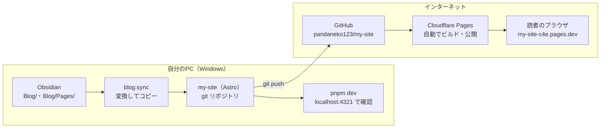

# ブログの処理フロー

記事を書いてから公開されるまでの流れ。`pnpm blog:publish` は「変換 → ビルド確認 → コミット → push」をまとめて行う。

| 段階 | やること | コマンド |
|---|---|---|
| 書く | Obsidian の `My knowledge/Blog/`（ページは `Blog/Pages/`）に `.md` を書く | — |
| 変換 | Obsidian の書き方を Astro 用に直し、`src/content/` にコピー | `pnpm blog:sync` |
| 確認 | 公開前の見た目を手元で見る | `pnpm dev` |
| 公開 | 変換・ビルド確認・コミット・push をまとめて実行。push を受けて Cloudflare Pages が自動で公開 | `pnpm blog:publish` |
