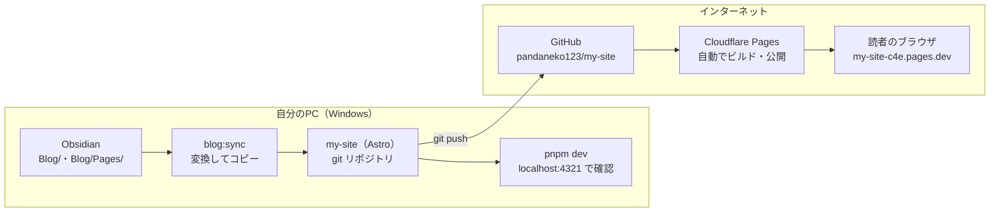
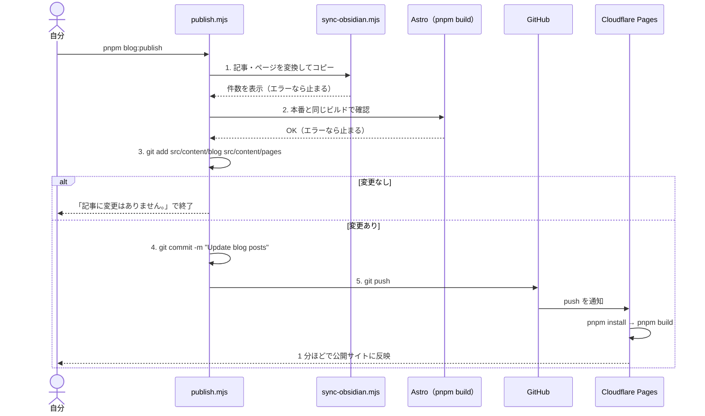

# ブログの処理フロー

記事を書いてから、読者のブラウザに表示されるまでの流れをまとめる。
どこに何があるか（サーバー・リポジトリ・バージョンなど）は [system-architecture.md](system-architecture.md) を参照。

（2026-10-18 時点の内容）

## 1. 全体の流れ



| 段階 | やること | コマンド | どこで動く |
|---|---|---|---|
| 1. 書く | Obsidian の `My knowledge/Blog/` に `.md` を書く（ページは `Blog/Pages/`） | — | PC |
| 2. 変換 | Obsidian の書き方を Astro 用に直し、`src/content/` にコピー | `pnpm blog:sync` | PC |
| 3. 確認 | 公開前の見た目を手元で見る | `pnpm dev` | PC |
| 4. 公開 | 変換・ビルド確認・コミット・push をまとめて行う | `pnpm blog:publish` | PC → GitHub |
| 5. ビルド・配信 | push を受けて、Cloudflare がビルドして配信する | （自動） | Cloudflare |

ふだんは「1. 書く → 4. 公開」だけでよい。見た目を確かめたいときだけ 2・3 をはさむ。

## 2. `pnpm blog:publish` の中で起きていること



| 順番 | 処理 | 失敗したとき |
|---|---|---|
| 1 | `node scripts/sync-obsidian.mjs`（下の 3 章） | エラー内容を表示して止まる。何もコミットされない |
| 2 | `pnpm build`（下の 4 章） | 記事の先頭情報の間違いなどで止まる。壊れたまま公開されることはない |
| 3 | `git add src/content/blog src/content/pages` | — |
| 4 | 変更があるか確認。なければ終了 | — |
| 5 | `git commit -m "Update blog posts"` | — |
| 6 | `git push` | ネットワークや認証の問題なら止まる。コミットは手元に残るので、あとで `git push` し直せばよい |

注意：

- コミットされるのは `src/content/blog` と `src/content/pages` だけ。**コード（デザインや設定）の変更は含まれない**ので、自分で `git add` → `git commit` → `git push` する
- ただし、実行する前に別のファイルを `git add` してあると、それも一緒にコミットされる
- Obsidian で記事を消すと、同期で `src/content/` からも消え、そのままコミットされる（公開サイトからも消える）

## 3. 変換・コピー（`pnpm blog:sync`）

`scripts/sync-obsidian.mjs` がやること。

### 3.1 処理の順番

1. Obsidian のフォルダがあるか確かめる（なければエラー）
2. `Blog/` の `.md` を記事、`Blog/Pages/` の `.md` をページとして集める（`.` で始まる隠しフォルダは無視）
3. 各ファイルの先頭情報（frontmatter）と本文を分ける
4. URL（slug）を決める
   - 記事 → `/blog/<slug>/`、ページ → `/<slug>/`
   - slug が重複していたらエラー
   - ページの slug が既存の URL（`blog`、`tags`、`index`、`rss.xml` など `src/pages/` にあるもの）と同じならエラー
5. `src/content/blog/` と `src/content/pages/` をいったん全部消して作り直す
6. 1 件ずつ、先頭情報を整えて、本文の Obsidian 記法を変換して書き出す
7. 使われた画像を `_assets/` にコピーする（画像がなければ `_assets/` は作らない）
8. 件数を表示する（例：`1 件の記事、1 件のページ、0 件の画像をコピーしました。`）

### 3.2 先頭情報の決まり方

| 出力する項目 | 決まり方（左から順に探す） | 記事 | ページ |
|---|---|---|---|
| `title` | `title` → 本文先頭の `# 見出し` → ファイル名 | ○ | ○ |
| `description` | `description` → 本文の最初の段落（80 文字まで） | ○ | ○ |
| `pubDate` | `pubDate` → `date` → ファイル名の `YYYY-MM-DD` → ファイルの更新日時 | ○ | — |
| `updatedDate` | `updatedDate` → `updated` | ○ | — |
| `tags` | `tags`（1 つだけでもよい） | ○ | — |
| `draft` | `draft: true` または `publish: false` | ○ | ○ |
| URL | `slug` → ファイル名（スペースは `-` に、`\ / ? # % " < > \| : *` は消す） | ○ | ○ |

本文先頭の `# 見出し` はタイトルとして使い、本文からは外す（ページ上で見出しが二重にならないように）。

### 3.3 本文の変換

| Obsidian の書き方 | 変換後 |
|---|---|
| `![[画像.png]]`、`![[画像.png\|300]]` | 保管庫全体からファイル名で画像を探してコピーし、`` に。見つからなければ警告を出して消す |
| ``（ローカルの画像） | 同じく探してコピーし、パスを書き換える。`http(s)://` の画像はそのまま |
| `[[記事名]]`、`[[記事名\|表示名]]`、`[[記事名#見出し]]` | 記事・ページへのリンク。ブログにないノートなら文字だけ残す |
| `==ハイライト==` | `<mark>ハイライト</mark>` |
| `%%コメント%%` | 消す（公開しない） |

コードブロック（` ``` ` で囲んだ部分）の中は変換しない。

## 4. ビルド（`pnpm build`）

`astro build` がやること。PC（publish の確認用）と Cloudflare（本番）の両方で同じ処理が動く。

1. `src/content.config.ts` の定義に合わせて、記事・ページの先頭情報をチェックする（型が違えばエラー）
2. `draft: true` の記事・ページを除く
3. `src/pages/` の各ファイルから全ページの HTML を作る
   - 記事は新しい順に並べ、トップには新着 5 件を出す
   - タグごとのページを、タグの数だけ作る
4. Markdown を HTML に変換する（1 行の改行もそのまま改行にする：remark-breaks）
5. `rss.xml` とサイトマップ（`sitemap-index.xml`）を作る
6. 結果を `dist/` に書き出す（いまは 12 ファイル、約 75KB）

## 5. 公開（Cloudflare Pages）

1. GitHub の `main` に push されると、Cloudflare に通知が届く
2. Cloudflare のビルド環境が、リポジトリを取ってきて `pnpm install` → `pnpm build` を実行する（Node 24、pnpm 12.14.0）
3. できた `dist/` を CDN にデプロイする
4. `https://my-site-c4e.pages.dev` に反映される（push から 1 分ほど）

ビルドが失敗した場合は、前回のデプロイが表示されたままになる（サイトが壊れることはない）。結果は Cloudflare ダッシュボードの Deployments で確認できる。

## 6. 記事以外を変えるとき

| 変えたいもの | 編集する場所 | 公開のしかた |
|---|---|---|
| 記事・About などのページ | Obsidian の `Blog/`、`Blog/Pages/` | `pnpm blog:publish` |
| サイト名・メニュー | `src/consts.ts` | 自分でコミットして push |
| デザイン | `src/styles/global.css`、`src/components/` | 自分でコミットして push |
| ページの仕組み | `src/pages/`、`src/layouts/` | 自分でコミットして push |

コードを変えたときのコマンド：

```bash
git add -A && git commit -m "変更内容" && git push
```

## 7. うまくいかないとき

| 表示・症状 | 原因 | 対処 |
|---|---|---|
| `Obsidian のフォルダが見つかりません` | 保管庫の場所が変わった | 保管庫を戻すか、環境変数 `OBSIDIAN_BLOG_DIR` で場所を指定する |
| `URL（slug）が重複しています` | 同じ slug の記事（またはページ）が 2 つある | どちらかの `slug` かファイル名を変える |
| `既存のページと URL がかぶっています` | `Blog/Pages/` に `blog.md` や `tags.md` などがある | ファイル名か `slug` を変える |
| `画像が見つかりません` | 画像のファイル名が違う、または保管庫にない | ファイル名を確かめる（その画像は表示されないまま公開される） |
| ビルドでエラー | 先頭情報の形が違う（日付の書き方など） | エラーに出ているファイルの先頭情報を直す |
| `記事に変更はありません。` | Obsidian 側で何も変わっていない | 正常。何もしなくてよい |
| 公開サイトが変わらない | Cloudflare のビルド中、または失敗 | 1 分ほど待つ。直らなければ Cloudflare の Deployments を見る |
| 記事を直したのに元に戻る | `src/content/` を直接直した | Obsidian 側を直す（`src/content/` は毎回作り直される） |
