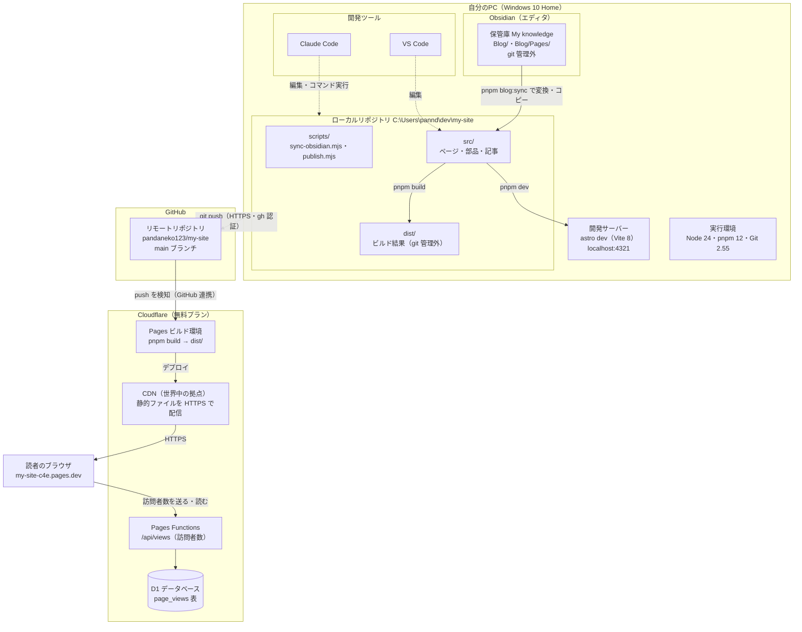

# システム構成

ブログ「my-site」を作って公開するための環境について、どこに何があるか、何が動いているか、どうつながっているかをまとめる。
記事を書いてから公開されるまでの手順は [blog-flow.md](blog-flow.md) を参照。

（2026-10-18 時点の内容）

## 1. 概要

- **サイトの種類**：静的サイト（SSG）。ビルドのときに全ページを HTML にしておき、アクセスがあったらそのファイルを返すだけ。ページ自体はサーバー側の処理なしで返す。例外は訪問者数カウンターだけで、Cloudflare Pages Functions（小さなサーバー処理）と D1（データベース）を使う
- **書く場所**：Obsidian（Markdown）
- **作る道具**：Astro 7（静的サイトジェネレーター）
- **ソースの置き場所**：GitHub（`pandaneko123/my-site`）
- **ビルドと公開**：Cloudflare Pages（GitHub への push で自動実行）
- **公開 URL**：<https://my-site-c4e.pages.dev>
- **費用**：0 円（すべて無料プランの範囲）

## 2. 全体図



## 3. 構成要素の詳細

### 3.1 自分のPC

| 項目 | 内容 |
|---|---|
| OS | Windows 10 Home（10.0.19045） |
| シェル | PowerShell 5.1 / Git Bash |
| エディタ | Obsidian（記事）、VS Code（コード） |
| AI アシスタント | Claude Code（Claude デスクトップアプリの Code タブ） |
| Node.js | 24.14.0（`package.json` で `>=22.22.0` を要求） |
| pnpm | 12.14.0（`package.json` の `packageManager` で固定） |
| Git | 2.55.0（Windows 版）。改行コードは `core.autocrlf=true`（取り出すときに CRLF、保存するときに LF） |
| GitHub CLI（gh） | `pandaneko123` でログイン済み。認証情報は Windows の資格情報ストア（keyring）に保存 |

#### Obsidian 保管庫

| 項目 | 内容 |
|---|---|
| 場所 | `C:\Users\pannd\obsidian\My knowledge` |
| ブログ記事 | `Blog/` 直下（とサブフォルダ）の `.md` |
| 単独ページ | `Blog/Pages/` の `.md`（`about.md` → `/about/`） |
| 画像 | 保管庫のどこに置いてもよい（同期のときにファイル名で探す） |
| バージョン管理 | git では管理していない |
| 同期 | Obsidian Sync のコアプラグインはオンになっているが、契約して実際に同期しているかはこのPCの設定ファイルからはわからない |
| 復元 | 「ファイルの復元」コアプラグインがオン（Obsidian 内に一定期間スナップショットが残る） |

保管庫には、ブログ以外の個人的なノート（家計・仕事など）も入っている。サイトにコピーされるのは `Blog/` の中の `.md` と、そこから参照されている画像だけ。

#### ローカルリポジトリ

場所は `C:\Users\pannd\dev\my-site`。中身は次のとおり。

```text
my-site/
├─ astro.config.mjs        Astro の設定（公開 URL、プラグイン）
├─ package.json            依存パッケージとコマンド
├─ pnpm-lock.yaml          依存パッケージの正確なバージョン
├─ .node-version           Cloudflare のビルドで使う Node のバージョン（24）
├─ tsconfig.json           TypeScript の設定（strict）
├─ README.md               使い方
├─ AGENTS.md               AI 向けのメモ
├─ docs/                   このドキュメント
├─ scripts/
│   ├─ sync-obsidian.mjs   Obsidian → src/content/ への変換・コピー
│   └─ publish.mjs         同期 → ビルド → コミット → push
├─ public/                 そのまま公開するファイル（favicon）
├─ src/
│   ├─ consts.ts           サイト名・説明・著者・メニュー
│   ├─ content.config.ts   記事（blog）とページ（pages）の型の定義
│   ├─ content/
│   │   ├─ blog/           記事（同期で毎回作り直す。直接編集しない）
│   │   └─ pages/          About などのページ（同上）
│   ├─ layouts/            BaseLayout（全ページ共通）、BlogPost（記事）
│   ├─ components/         ヘッダー、フッター、<head>、記事一覧、タグなど
│   ├─ pages/              URL になるファイル（下の表）
│   ├─ styles/global.css   見た目（Bear Blog の CSS がベース）
│   └─ utils/posts.ts      記事の取得・並べ替え・タグ集計
├─ node_modules/           依存パッケージ（約 148MB、git 管理外）
├─ dist/                   ビルド結果（git 管理外）
└─ .vscode/                VS Code の推奨拡張・デバッグ設定
```

git で管理しないもの（`.gitignore`）：`dist/`、`.astro/`、`node_modules/`、ログ、`.env`。

#### 開発サーバー

| 項目 | 内容 |
|---|---|
| 起動 | `pnpm dev`（中身は `astro dev`）。VS Code の「Development server」からも起動できる |
| 仕組み | Astro が Vite 8 の開発サーバーを立ち上げる。ファイルの保存を監視して、ブラウザを自動で更新する |
| URL | <http://localhost:4321>（自分のPCからだけ見られる） |
| 下書き | `draft: true` の記事・ページも表示される（本番では出ない） |
| 確認用の別サーバー | `pnpm preview` で、`dist/` をそのまま返すサーバーも起動できる（本番に近い確認用） |

### 3.2 GitHub

| 項目 | 内容 |
|---|---|
| リポジトリ | <https://github.com/pandaneko123/my-site> |
| ブランチ | `main` のみ（これが本番） |
| 接続方法 | HTTPS。認証は gh の credential helper（パスワードや鍵を手で入れない） |
| 役割 | ソースコードと記事（変換後）のバックアップ兼、Cloudflare Pages のビルドのきっかけ |

### 3.3 Cloudflare Pages

| 項目 | 内容 |
|---|---|
| つなぎ方 | Cloudflare ダッシュボードから GitHub リポジトリに接続（GitHub 連携） |
| ビルドのきっかけ | 本番ブランチ（`main`）への push。ほかのブランチを push するとプレビュー用 URL が作られる |
| ビルド設定 | Framework preset：Astro / Build command：`pnpm build` / Output：`dist` |
| ビルド環境 | Cloudflare が用意する Linux のコンテナ。Node は `.node-version`（24）、pnpm は `packageManager`（12.14.0）を見て合わせる |
| 配信 | `dist/` のファイルを Cloudflare の CDN（世界中の拠点）にデプロイ。読者は一番近い拠点からファイルを受け取る |
| Web サーバー | 自分で用意・管理する Web サーバー（nginx や Apache など）はない。Cloudflare の配信基盤がその役割をする |
| HTTPS | 証明書は自動で発行・更新される |
| URL | `https://my-site-c4e.pages.dev`（独自ドメインはまだない） |
| 反映までの時間 | push してから 1 分ほど |

※ 設定内容は README の手順とリポジトリの設定ファイルからまとめたもの。Cloudflare ダッシュボードの実際の画面はここでは確認していない。

### 3.4 訪問者数カウンター

フッターに「今日 ○ 人／累計 ○ 人」、記事の日付の横に「○ 回閲覧」を表示する。

| 項目 | 内容 |
|---|---|
| 表示する部品 | `src/components/VisitCounter.astro`（フッターに入っている）。記事の閲覧数の表示場所は `src/layouts/BlogPost.astro` |
| API | `functions/api/views.js`（Cloudflare Pages Functions）。`/api/views` で動く |
| データベース | Cloudflare D1。Pages プロジェクトに `DB` という名前で結び付ける。表（`page_views`）は API が最初に自動で作る |
| 数え方 | 訪問者：同じブラウザは、その日（日本時間）のうちは 1 人（一般的な「1 日のユニークユーザー」）。閲覧：同じブラウザ・同じページは、その日のうちは 1 回。どちらもブラウザの localStorage に残した記録で見分ける |
| 数えないもの | 「数えない」設定にしたブラウザ（下記）、自動操作のブラウザ（`navigator.webdriver`）、存在しないページ（404）、サイト外の URL |
| 自分を数えない | URL の最後に `?nocount` を付けて 1 回開くと、そのブラウザはそれ以降数えない（フッターに「このブラウザは数えていません」と出る）。`?count` を付けて開くと元に戻る。ブラウザごとの設定なので、PC とスマホなどそれぞれで 1 回ずつ開く。サイトデータを消すと設定も消える |
| 「今日」の区切り | 日本時間の 0 時 |
| 動かないとき | `pnpm dev` や DB 未設定のときは API が使えないので、数字の部分は表示されない（ページは普通に見られる） |
| 手元での確認 | `wrangler pages dev` でローカルの D1 を使って確認できる（[blog-flow.md](blog-flow.md) の 8 章） |

表の中身（集計済みの行だけを持つので、1 回の表示で読むのは 3 行だけ）：

| path | day | count の意味 |
|---|---|---|
| `/blog/xxx/` など | `total` | そのページの累計閲覧数 |
| `*` | `2026-10-25` など | その日のサイト全体の訪問者数 |
| `*` | `total` | サイト全体の累計訪問者数 |

人数はおおよその数。別のブラウザやスマホから来た同じ人は、別の訪問者として数える。「累計」は毎日の訪問者数を足した数なので、同じ人が 3 日来たら累計は 3 人増える。ブラウザに残す記録は「その日に数えたページ」だけで、人を識別する ID は使っていない。

### 3.5 公開サイト

| URL | 中身 | 元になるファイル |
|---|---|---|
| `/` | トップ（新着 5 件） | `src/pages/index.astro` |
| `/blog/` | 記事一覧 | `src/pages/blog/index.astro` |
| `/blog/<slug>/` | 記事 | `src/pages/blog/[...slug].astro` + `src/content/blog/` |
| `/tags/` | タグ一覧 | `src/pages/tags/index.astro` |
| `/tags/<タグ>/` | タグごとの記事一覧 | `src/pages/tags/[tag].astro` |
| `/<slug>/` | About などのページ | `src/pages/[page].astro` + `src/content/pages/` |
| `/api/views` | 訪問者数 API（ページではない） | `functions/api/views.js` |
| 存在しない URL | 404 ページ | `src/pages/404.astro` |
| `/rss.xml` | RSS フィード | `src/pages/rss.xml.js` |
| `/sitemap-index.xml` | サイトマップ（検索エンジン向け） | `@astrojs/sitemap` が自動生成 |

すべてのページに入るもの（`src/components/BaseHead.astro`）：

- タイトル（`記事名 | サイト名`）、説明文、canonical URL
- OGP / Twitter カード（SNS でシェアしたときの表示）
- favicon、RSS とサイトマップへのリンク

現在のビルド結果は 12 ファイル、合計約 75KB。

## 4. ソフトウェア構成

| パッケージ | バージョン | 役割 |
|---|---|---|
| astro | 7.4.0 | 静的サイトジェネレーター本体 |
| vite | 8.3.4 | Astro が内部で使う開発サーバー・ビルドツール |
| @astrojs/mdx | 8.1.x | `.mdx`（Markdown の中に部品を書ける形式）を使えるようにする |
| @astrojs/markdown-remark | 7.3.x | Markdown を HTML に変換する |
| remark-breaks | 4.0.0 | Obsidian と同じく、1 行の改行もそのまま改行にする |
| @astrojs/rss | 4.0.x | RSS フィードを作る |
| @astrojs/sitemap | 3.7.x | サイトマップを作る |
| sharp | 0.35.5 | 画像の変換・縮小（記事のヒーロー画像など） |
| yaml | 2.9.1 | 同期スクリプトで記事の先頭情報（frontmatter）を読み書きする |

`astro.config.mjs` の主な設定：

- `site: 'https://my-site-c4e.pages.dev'`（canonical URL・RSS・サイトマップに使う）
- `integrations: [mdx(), sitemap()]`
- `markdown.remarkPlugins: [remarkBreaks]`
- 出力モードは既定の `static`（アダプターなし）。サーバーで動くのは `functions/` の訪問者数 API だけで、これは Astro ではなく Cloudflare Pages が直接動かす

## 5. 認証と接続

| 接続 | 方式 | 認証情報の置き場所 |
|---|---|---|
| PC → GitHub（git push） | HTTPS | gh の credential helper → Windows の資格情報ストア |
| GitHub → Cloudflare | Cloudflare の GitHub 連携（GitHub App） | Cloudflare と GitHub のアカウント側 |
| Pages Functions → D1 | Pages プロジェクトの設定で結び付け（バインディング名 `DB`） | Cloudflare のアカウント側（キーはコードに入っていない） |
| 読者 → Cloudflare | HTTPS | 不要（公開サイト） |

リポジトリにパスワードや API キーは入っていない（`.env` も git 管理外）。

## 6. データの置き場所とバックアップ

| データ | 元データ | コピーがある場所 |
|---|---|---|
| 記事・ページの原稿 | Obsidian 保管庫（PC） | 変換後のものが `src/content/` → GitHub |
| 記事の画像 | Obsidian 保管庫（PC） | `src/content/*/_assets/` → GitHub |
| サイトのコード・設定 | ローカルリポジトリ（PC） | GitHub |
| 公開中のサイト | Cloudflare（`dist/` のデプロイ） | 過去のデプロイも Cloudflare に残る |
| 訪問者数 | Cloudflare D1 | D1 の Time Travel で過去 7 日以内の状態に戻せる（無料プラン） |

注意点：

- **Obsidian 保管庫は git で管理していない**。公開した記事は変換後の形で GitHub に残るが、下書き・ブログ以外のノートは、Obsidian Sync を使っていなければ PC の中にしかない
- `src/content/` は同期のたびに作り直されるので、ここを直接直しても次の同期で消える

## 7. 費用と無料枠

| サービス | プラン | 主な制限（無料プラン） |
|---|---|---|
| GitHub | Free | 個人ブログの使い方なら制限にかからない |
| Cloudflare Pages | Free | ビルド 500 回/月、1 サイトあたり 20,000 ファイル、1 ファイル 25MiB まで。帯域は無制限 |
| Pages Functions | Free（Workers の無料枠） | 10 万リクエスト/日（1 ページ表示で 1 回使う） |
| Cloudflare D1 | Free | 読み取り 500 万行/日、書き込み 10 万行/日、保存 5GB。1 回の表示で読み取り約 3 行、書き込み最大 3 行 |
| Obsidian | 無料（Sync は有料オプション） | — |

※ 無料枠の数字は変わることがあるので、気になったときは各サービスの公式ページで確認する。

## 8. 今後の候補

- 独自ドメインを付ける（Cloudflare でドメインを設定 → `astro.config.mjs` の `site` を書き換える）
- Obsidian 保管庫のバックアップ方法を決める（Obsidian Sync、または保管庫の git 管理）
- OGP 画像を自動で作る
