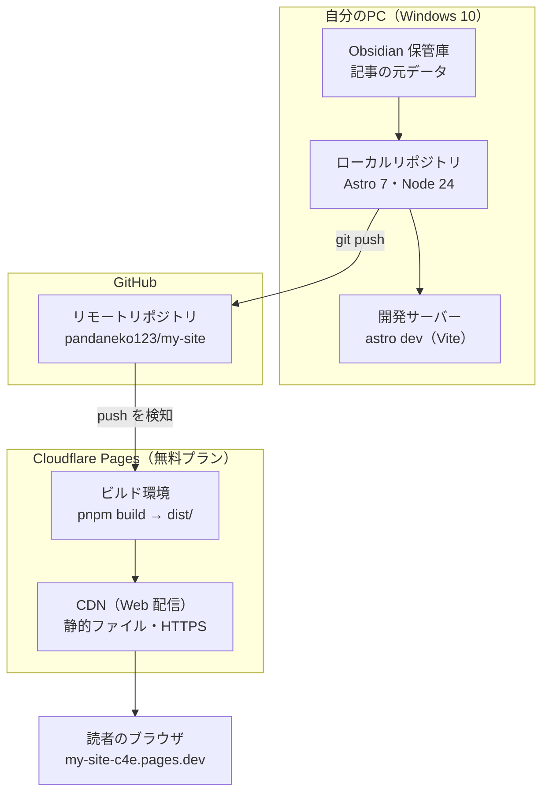

# システム構成

どこに何があって、何が動いているか。処理の流れは [blog-flow.md](blog-flow.md) を参照。

## 構成要素

| 場所 | 要素 | 中身 |
|---|---|---|
| 自分のPC | Obsidian 保管庫 | `C:\Users\pannd\obsidian\My knowledge`。記事は `Blog/`、ページは `Blog/Pages/`。git では管理していない |
| 自分のPC | ローカルリポジトリ | `C:\Users\pannd\dev\my-site`。Astro 7.4 / Node 24 / pnpm 12 / Git 2.55 |
| 自分のPC | 開発サーバー | `pnpm dev`（中身は Astro と Vite）。`http://localhost:4321`。自分のPCからだけ見られる |
| GitHub | リモートリポジトリ | `https://github.com/pandaneko123/my-site`、`main` ブランチ |
| Cloudflare | ビルド環境 | `main` への push を検知して、`pnpm build` で `dist/` を作る。Node のバージョンは `.node-version`、pnpm は `package.json` の `packageManager` で固定している |
| Cloudflare | CDN（Web 配信） | `dist/` の静的ファイルを世界中の拠点から配信する。自分で管理する Web サーバーはない。HTTPS も自動 |
| インターネット | 公開 URL | `https://my-site-c4e.pages.dev`（独自ドメインを付けたら `astro.config.mjs` の `site` を書き換える） |

費用はすべて無料プランの範囲。
